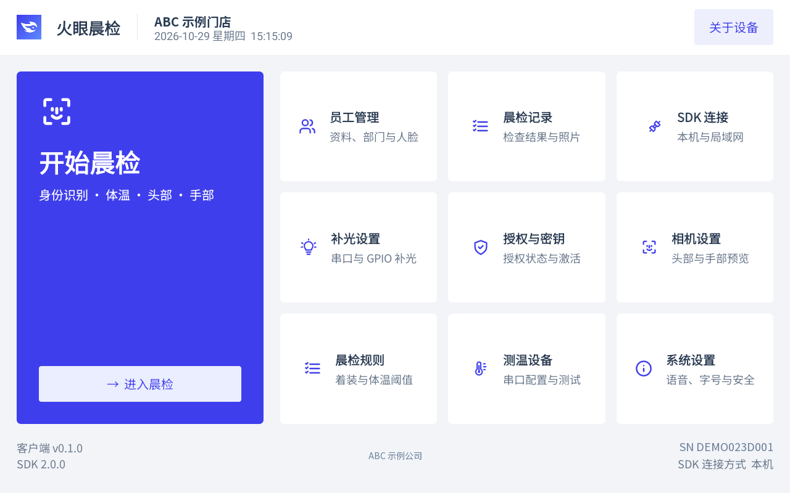
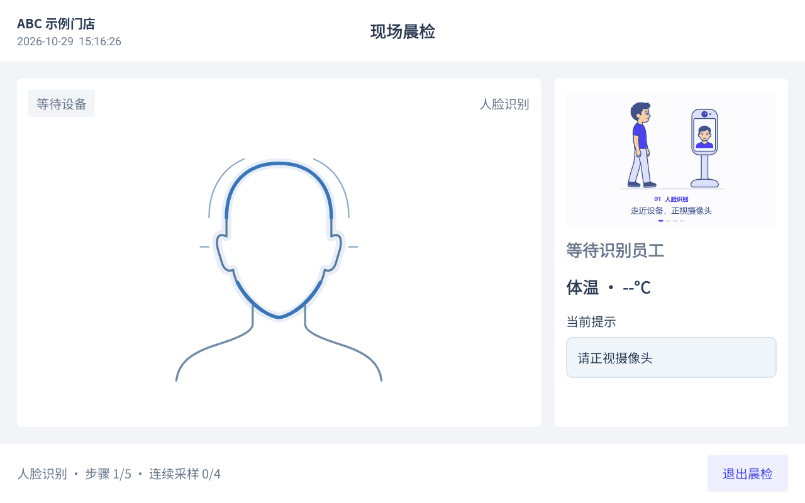

# Huoyan Open Source Morning Check Android App

A native Android client for staff morning checks in **catering, canteens, and food production**. Run the complete App or integrate the client JAR into your own Android application.

[简体中文](README.md) · [Website and activation](https://www.huoyan.cc) · [Downloads](https://github.com/huoyan-ai-opensource/huoyan-opensource-morningcheck-android/releases) · [Quick start](QUICKSTART.md) · [Documentation](docs/README.md)

**Everyone can use the source; AI recognition requires contacting Huoyan to activate the matching SDK.** See [usage and activation](USAGE.md) and [third-party notices](THIRD_PARTY_NOTICES.md) for the scope of the App source, SDK authorization, and bundled components.

## Choose how to use it

| Goal | Start here |
| --- | --- |
| Install and try the complete App | [Quick start](QUICKSTART.md): install the App and SDK → activate and prepare models → add staff → enroll faces → run a check → view records |
| Integrate recognition into your own App | [English integration guide](huoyanClient/INTEGRATION_GUIDE.en.md) · [Chinese integration guide](huoyanClient/INTEGRATION_GUIDE.md) · [Java example](huoyanClient/samples/MorningClientExample.java) |
| Modify this project | [Build environment](docs/build.md) → [Code structure](docs/code-structure.md) → [Testing](docs/testing.md) → [Contributing](CONTRIBUTING.md) |

The complete App uses package `cc.huoyan.opensource.morningcheck`; the JAR's public API is under `cc.huoyan.morningcheck.sdk.client`. The separately installed morning check SDK uses package `cc.huoyan.morningcheck`. The JAR handles communication and contains no inference engine or models.

## Features and interface

- Staff and department management, unique required staff numbers, health certificate dates, search, filters, and pagination.
- Face enrollment with staff selection and capture on one page, sample previews, single-image deletion, and clearing one staff member's samples.
- Automatic identity, configured head, back-of-hand, and palm checks; temperature capture follows the rules. Continuous checks show a next-person countdown with an option to stay.
- Local records and captured photos, date-range and result filters, pagination, and record details.
- Camera2 and USB UVC cameras, serial thermometers with indoor/outdoor/trigger modes, and serial/GPIO lighting.
- Speech, font size, security password, automatic entry after boot, and local/LAN SDK connection and activation settings.

| Home | Morning check |
| --- | --- |
|  |  |

These Chinese landscape screens were captured on a YF023D on October 29, 2026. Company, workplace, and device serial identifiers have been replaced with fictional sample values. The check screen shows the waiting-for-device guide with no real-person photos. Both READMEs use the same two-column layout. The device had App 0.1.0 and SDK 2.0.0 installed; these screenshots do not establish complete hardware acceptance for App 2.0.0. See [image details](docs/images/README.md). Landscape and portrait layouts are maintained in the [shared design source](design/huoyan-morningcheck.pen).

## Downloads and activation

The App APK, client JAR, distribution ZIP, Chinese and English Word integration guides, and SHA-256 checksums are distributed through [GitHub Releases](https://github.com/huoyan-ai-opensource/huoyan-opensource-morningcheck-android/releases). Both Word guides retain their project filenames inside the ZIP and in Assets; see [release requirements](docs/releasing.md). You can also [build from source](docs/build.md).

The SDK installation guide uses [morningcheck_sdk_lastest.apk](http://f.huoyan.cc/apk/morningcheck_sdk_lastest.apk) by default. Contact Huoyan through the [website](https://www.huoyan.cc) to confirm the device, chipset, application package, activation, and model support. The existing filename uses `lastest`; it is a moving SDK download address, not proof of a compatible fixed version. See [version compatibility](docs/version-compatibility.md).

A successful connection, `init=0`, or `activate=0` does not establish readiness. The client's `isReady()` requires a connection, state `READY` or `OFFLINE`, `model_ready=true`, `certificate_valid=true`, and no lost key. `OFFLINE` supports local recognition, detection, and enrollment when those conditions hold; it does not make cloud APIs available. The SDK shell applies the final admission rules to each command. Follow the [quick start](QUICKSTART.md) for deployment.

Rules determine whether to measure temperature or check masks and work caps; disabling temperature records an unmeasured value. Records and photos currently remain on the client device. Record upload, supplementary photos, manual review, and online App updates are not provided.

## Build and test

Use JDK/JBR **17**, Android SDK **35**, Build Tools **35.0.0**, and the included Gradle **8.14.3** Wrapper. Java source and target compatibility are **11**. This project does not build the native SDK engine and declares no NDK or CMake build. See the [build guide](docs/build.md) for Android Studio, SDK paths, and signing.

Windows PowerShell, after configuring `JAVA_HOME`:

```powershell
.\gradlew.bat :app:assembleDebug
.\gradlew.bat :app:testDebugUnitTest :huoyanClient:testDebugUnitTest
```

macOS / Linux:

```bash
bash gradlew :app:assembleDebug
bash gradlew :app:testDebugUnitTest :huoyanClient:testDebugUnitTest
```

The App consumes the committed `app/src/main/libs/huoyan-morningcheck-client-2.0.0.jar`; an App build does not update it automatically. After changing client source, run `:huoyanClient:updateAppSdkJar` before rebuilding the App. Generate the complete client ZIP with `:huoyanClient:clientDistribution`. App and JAR versions are independent; both use `2.0.0` for this release baseline.

Debug uses the local debug signing key. Release defaults to the public [experimental key](signing/README.en.md), solely for noncommercial experiments and testing. Use your own key for production releases and configure it in the untracked `local.properties`. The experimental key's restrictions are separate from the use of Huoyan's own App source.

## Documentation and collaboration

| Topic | Documents |
| --- | --- |
| Run and use | [Quick start](QUICKSTART.md) · [Hardware](docs/hardware.md) · [FAQ](docs/faq.md) |
| Develop and deliver | [Build](docs/build.md) · [Testing](docs/testing.md) · [Versions](docs/version-compatibility.md) · [Releasing](docs/releasing.md) · [Changelog](CHANGELOG.md) |
| Client JAR | [English client README](huoyanClient/README.en.md) · [Account configuration and packaging](huoyanClient/PACKAGING.md) |
| Word integration guides | [English](app/src/main/libs/huoyan-morningcheck-client-2.0.0-integration-guide.en.docx) · [Chinese](app/src/main/libs/huoyan-morningcheck-client-2.0.0-integration-guide.zh-CN.docx), alongside the JAR in `app/src/main/libs/` |
| Support and contributions | [Support](SUPPORT.md) · [Contributing](CONTRIBUTING.md) · [Security](SECURITY.md) · [Community guidelines](CODE_OF_CONDUCT.md) |

Submit ordinary issues and pull requests on [GitHub](https://github.com/huoyan-ai-opensource/huoyan-opensource-morningcheck-android). Include the source platform, commit, relevant versions, and any existing discussion links. Send activation codes, accounts, security reports, and employee data through the [private reporting channels](SECURITY.md).

Maintainers trigger GitHub build checks and releases manually. Branch pushes, pull requests, and version tags do not automatically build or publish. See [release instructions](docs/releasing.md) and the coding-agent rules in [AGENTS.md](AGENTS.md).
