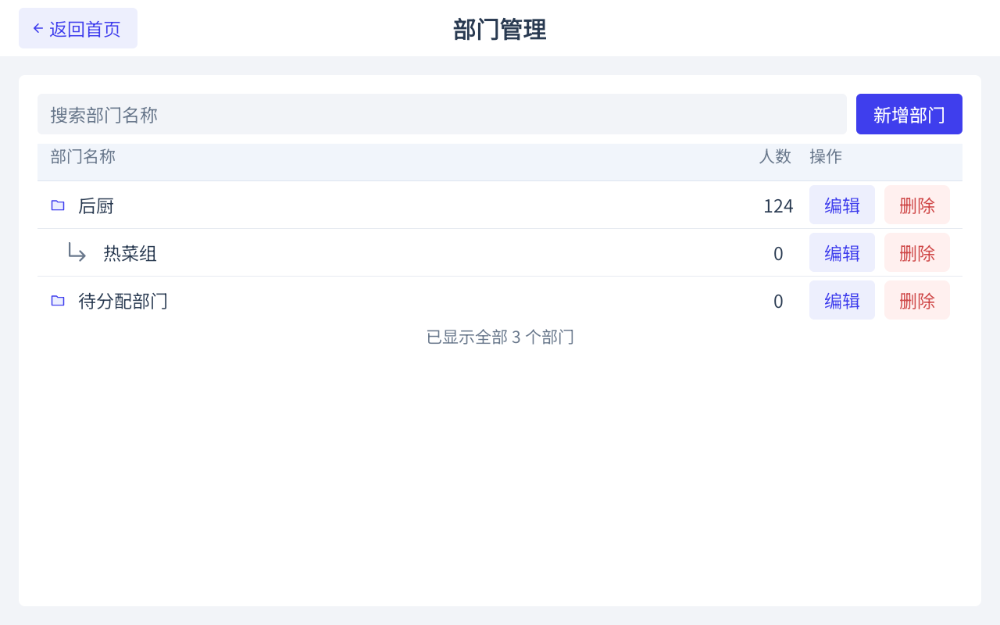

# Huoyan Open Source Morning Check Android App

[简体中文](README.md) | English

[GitHub repository](https://github.com/huoyan-ai-opensource/huoyan-opensource-morningcheck-android) · [Issues](https://github.com/huoyan-ai-opensource/huoyan-opensource-morningcheck-android/issues)

A native Android client for staff morning checks in catering, food production, and similar workplaces. Administrators manage staff and departments and enroll faces. Staff then complete identity, head, back-of-hand, and palm checks at the device. Records and captured evidence remain on the client device.

The App uses Java, XML layouts, and separate Activities. It connects to the independently installed Huoyan Morning Check 2.0 SDK. The App and client JAR source are available for everyone to use; AI recognition, detection, and enrollment require a compatible SDK, model, and activation. See [usage and activation](USAGE.md) (Chinese).

| Goal | Start here |
| --- | --- |
| Install, activate, and complete a check | [Quick start](QUICKSTART.md) (Chinese) |
| Build with Android Studio or the command line | [Build guide](docs/build.md) (Chinese) |
| Integrate the SDK into your own App | [Client JAR](huoyanClient/README.md) · [Java examples](huoyanClient/samples) |
| Read the Word guide offline | [English](app/src/main/libs/huoyan-morningcheck-client-2.0.0-integration-guide.en.docx) · [Chinese](app/src/main/libs/huoyan-morningcheck-client-2.0.0-integration-guide.zh-CN.docx) |
| Check hardware and compatibility | [Hardware](docs/hardware.md) · [FAQ](docs/faq.md) · [Versions](docs/version-compatibility.md) (Chinese) |
| Contribute or ask for help | [Contributing](CONTRIBUTING.md) · [Support](SUPPORT.md) · [Security](SECURITY.md) (Chinese) |

## Features and scope

| Feature | Current behavior |
| --- | --- |
| Staff and departments | Required unique staff numbers, names, health certificate dates, enabled state, department hierarchy, search, filters, and pagination |
| Face enrollment | Select staff and capture on one page; view SDK sample images, delete one sample, or clear a staff member's samples |
| Automatic check | Identity and temperature → configured mask/hat checks → backs of hands → palms → save results |
| Continuous checks | Result countdown with an option to stay; the same person must leave the camera view before another round |
| Records | Date range, result, department, name and staff number filters, pagination, details, and evidence images |
| Hardware | Camera2 / USB UVC, serial thermometers, indoor/outdoor/trigger modes, serial/GPIO lighting |
| Settings | Speech, font size, security password, automatic entry after boot, and workplace name |
| SDK connection | Local AIDL or local/LAN WebSocket, installation guidance, activation, and authorization details |

Head checks and temperature capture follow the configured rules. Each round keeps its starting rules. Disabling temperature records an unmeasured value rather than a fabricated reading. Recognition quality and hardware support must be checked on the deployment device.

Records and check photos are currently local only. Record upload, supplementary photos, manual review, and online App updates are not provided. Business-cloud staff import is separate from SDK activation and requires its own service configuration.

## Interface example



Department management with test departments and counts, captured on October 15, 2026. This image illustrates the layout; consult the current source for subsequent features and behavior.

## Get started

1. Build and install the App using the [build guide](docs/build.md), then install the matching SDK on the device providing recognition.
2. Contact Huoyan through [www.huoyan.cc](https://www.huoyan.cc) to confirm hardware, application package, and models, and obtain activation details.
3. Configure cameras and any thermometer or light, add a test staff member, and enroll their face.
4. Start a morning check and verify the saved result and evidence. Follow the [quick start](QUICKSTART.md) for the full procedure.

The project repository is [huoyan-ai-opensource/huoyan-opensource-morningcheck-android](https://github.com/huoyan-ai-opensource/huoyan-opensource-morningcheck-android). No Release has been published and hosted CI has not run yet. Build from source until maintainers publish downloadable [GitHub Releases](https://github.com/huoyan-ai-opensource/huoyan-opensource-morningcheck-android/releases). App, JAR, and SDK versions are independent; see [compatibility](docs/version-compatibility.md) and the [changelog](CHANGELOG.md).

## Build

Use JDK 17, Android SDK 35, and the included Gradle Wrapper:

```bash
bash gradlew :app:assembleDebug
bash gradlew :app:testDebugUnitTest :huoyanClient:testDebugUnitTest :huoyanClient:compileExample :huoyanClient:clientDistribution
```

On Windows PowerShell, replace `bash gradlew` with `.\gradlew.bat`. See the [build guide](docs/build.md) for the toolchain, SDK location, signing, and outputs.

The App consumes the committed `app/src/main/libs/huoyan-morningcheck-client-2.0.0.jar`. After changing client source or its version, run `:huoyanClient:updateAppSdkJar` before rebuilding the App. The client ZIP includes both Word guides, using the same filenames in the project, ZIP, and Release Assets. See [release requirements](docs/releasing.md). Build and release workflows are manual only.

## Documentation and terms

The [documentation index](docs/README.md) covers builds, tests, deployment, and releases. [Code structure](docs/code-structure.md) explains Activities, the check pipeline, storage, and SDK sessions.

[Usage and activation](USAGE.md) separates App/JAR source, SDK models, and third-party components. This repository has not selected a single standard license such as MIT or Apache 2.0 for the entire project. See [third-party notices](THIRD_PARTY_NOTICES.md) and [signing](signing/README.md).

Remove face images, health certificates, activation codes, account tokens, and full device identifiers before public feedback. Report sensitive issues privately as described in [SECURITY.md](SECURITY.md).
